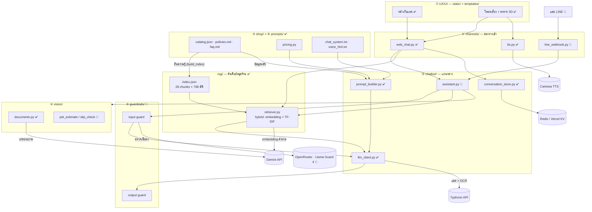
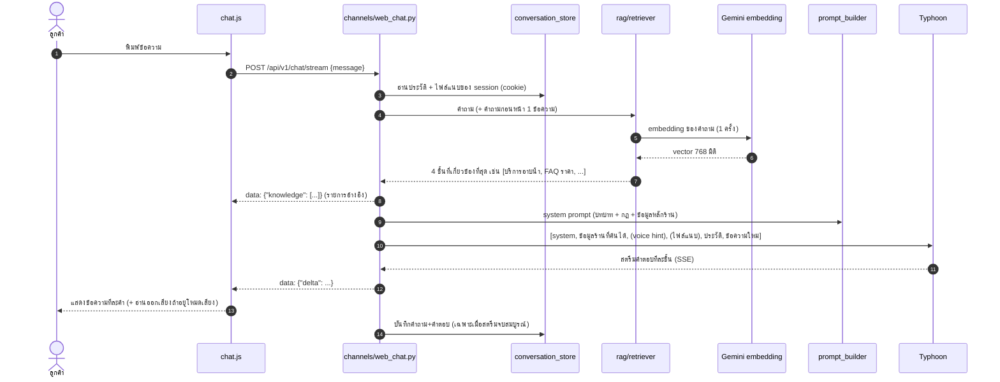
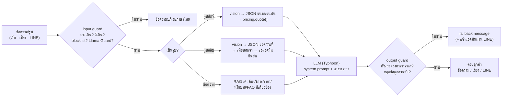

# สถาปัตยกรรมระบบ — แชทบอทร้าน Hom Hom Grooming

> สถานะ ณ 28 ก.ย. 2569 · branch `refactor/folder-structure`
> ✅ = ทำแล้ว · 🚧 = วางแผนแล้ว ยังไม่ได้ทำ

แชทบอทตอบลูกค้าแทนเจ้าของร้าน ตามเงื่อนไขของโจทย์ 3 ข้อ:
1. ตอบจากข้อมูลจริงของร้านเท่านั้น ห้ามแต่งข้อมูลเอง
2. ลูกค้าใช้งานได้เองโดยไม่ต้องมีคนอธิบาย
3. ไม่ถูกหลอกให้ทำสิ่งที่ร้านไม่อนุญาต (ส่วนลดเกินจริง เปิดเผยข้อมูลลูกค้าอื่น นโยบายที่ไม่มี)

---

## 1. ภาพรวม 7 ชั้น

ระบบแบ่งตามชั้นของสถาปัตยกรรม และ **แต่ละชั้นคือโฟลเดอร์หนึ่งโฟลเดอร์** ในโค้ด



> ตอนนี้ `web_chat.py` ยังเรียก `llm_client` ตรงๆ อยู่ `assistant.py` คือแกนกลางที่จะย้าย logic
> มารวมไว้ เพื่อให้เว็บ, โหมดเสียง และ LINE ผ่าน guard และ prompt ชุดเดียวกันทั้งหมด

---

## 2. หน้าที่ของแต่ละโฟลเดอร์

| ชั้น | โฟลเดอร์ / ไฟล์ | หน้าที่ | สถานะ |
|---|---|---|---|
| — | `main.py` | สร้าง FastAPI app, รวม router, เสิร์ฟหน้าเว็บ | ✅ |
| — | `config.py` | อ่านค่าตั้งค่าจาก `.env` (pydantic-settings) | ✅ |
| — | `api/index.py` | จุดเข้าของ Vercel (import app จาก `main.py`) | ✅ |
| ① | `channels/web_chat.py` | API ของหน้าเว็บ: แชต, สตรีม, History, ไฟล์แนบ | ✅ |
| ① | `channels/tts.py` | proxy เสียง Cartesia (เก็บ key ไว้ฝั่งเซิร์ฟเวอร์) | ✅ |
| ① | `channels/line_webhook.py` | รับข้อความ/รูปจาก LINE OA, ตรวจลายเซ็น, ตอบกลับ | 🚧 |
| ② | `chatbot/llm_client.py` | เรียก LLM แบบ OpenAI-compatible, retry เมื่อ 429/5xx, แปล error เป็นไทย | ✅ |
| ② | `chatbot/prompt_builder.py` | ประกอบ system prompt จาก `prompts/` + `shop/` | ✅ |
| ② | `chatbot/conversation_store.py` | ประวัติแชตต่อ session (in-memory หรือ Redis) | ✅ |
| ② | `chatbot/search.py` | ค้นเว็บ (Tavily) — **ปิดไว้** เพราะบอทร้านต้องตอบจากข้อมูลร้านเท่านั้น | ✅ (ปิด) |
| ② | `chatbot/assistant.py` | pipeline กลาง: guard → เลือกงาน → LLM → guard | 🚧 |
| RAG | `rag/chunker.py` | แบ่ง `shop/` เป็น 28 ชิ้นตามความหมาย (บริการละชิ้น, หัวข้อนโยบาย/FAQ ละชิ้น) | ✅ |
| RAG | `rag/retriever.py` | ค้นแบบ hybrid: 0.7 × cosine ของ embedding + 0.3 × TF-IDF character n-gram, top 4 | ✅ |
| RAG | `rag/embedder.py`, `build_index.py`, `index.json` | สร้าง embedding ล่วงหน้า (Gemini `gemini-embedding-001`, 768 มิติ) | ✅ |
| ③ | `guardrails/` | blocklist, จำกัดความยาว/ความถี่, Llama Guard, ตรวจคำตอบขาออก | 🚧 |
| ④ | `vision/documents.py` | อ่านไฟล์แนบ: PDF (pymupdf), รูป (typhoon-ocr + Gemini) | ✅ |
| ④ | `vision/pet_estimate.py`, `slip_check.py` | รูปสัตว์ → ประเมินราคา, รูปสลิป → ตรวจยอด | 🚧 |
| ⑤ | `shop/catalog.json` | ข้อมูลร้าน + ราคาทั้งหมด (**แหล่งข้อมูลเดียว**) | ✅ |
| ⑤ | `shop/policies.md`, `faq.md` | นโยบายร้าน, FAQ 10 ข้อ | ✅ |
| ⑤ | `shop/pricing.py` | คำนวณราคาด้วยโค้ด + สร้างตารางราคาให้ prompt | ✅ |
| ⑥ | `prompts/chat_system.txt` | บทบาท / แหล่งข้อมูลที่ใช้ได้ / ต้องทำ 8 ข้อ / ห้ามทำ 7 ข้อ / fallback + ข้อมูลหลักร้าน | ✅ |
| ⑥ | `prompts/voice_hint.txt` | คำสั่งเสริมโหมดเสียง (ตอบสั้น ไม่มี markdown) | ✅ |
| ⑦ | `templates/index.html`, `static/js/chat.js` | หน้าแชต, สตรีมข้อความ, History, แนบไฟล์ | ✅ |
| ⑦ | `static/js/voice.js` | โหมดเสียง: STT (Web Speech API `th-TH`) → แชต → TTS | ✅ |
| ⑦ | `static/js/voice-avatar.js`, `static/avatar/` | อวตาร VRM (three.js + three-vrm) ขยับปาก/ท่าทางตามเสียง | ✅ (ยังเป็นโมเดลตัวอย่าง) |

---

## 3. เส้นทางของ 1 ข้อความ (Data flow)

### 3.1 ปัจจุบัน ✅

ลูกค้าพิมพ์ "อาบน้ำหมาพันธุ์ปอมเท่าไหร่คะ" บนหน้าเว็บ



### 3.2 เป้าหมาย 🚧



---

## 4. API endpoints

| Method | Path | หน้าที่ | สถานะ |
|---|---|---|---|
| GET | `/` | หน้าเว็บแชต | ✅ |
| GET | `/health` | เช็คว่าเซิร์ฟเวอร์รันอยู่ | ✅ |
| GET | `/api/v1/config` | ค่าเริ่มต้นให้หน้า Settings (ไม่หลุด API key) | ✅ |
| POST | `/api/v1/chat` | แชตแบบรอคำตอบเต็ม | ✅ |
| POST | `/api/v1/chat/stream` | แชตแบบสตรีม (SSE) — ใช้ทั้งหน้าเว็บและโหมดเสียง (`voice: true`) | ✅ |
| POST | `/api/v1/chat/reset` | ล้างบทสนทนาปัจจุบัน | ✅ |
| GET | `/api/v1/history` | ข้อความของบทสนทนาที่ active | ✅ |
| GET / POST | `/api/v1/conversations` | รายการบทสนทนา / สร้างบทใหม่ | ✅ |
| POST | `/api/v1/conversations/{cid}/activate` | สลับบทสนทนา | ✅ |
| DELETE | `/api/v1/conversations/{cid}` | ลบบทสนทนา | ✅ |
| GET / POST | `/api/v1/attachments` | ดู / แนบไฟล์ (PDF, รูป, ข้อความ) | ✅ |
| DELETE | `/api/v1/attachments/{index}` | ลบไฟล์แนบ | ✅ |
| GET | `/api/v1/models` | รายชื่อโมเดล (Typhoon ไม่มี endpoint นี้ ระบบ fallback ให้) | ✅ |
| GET | `/api/v1/tts/config` | โหมดเสียงใช้ Cartesia ได้ไหม | ✅ |
| POST | `/api/v1/tts/stream` | แปลงข้อความเป็นเสียง PCM 24kHz (สตรีม) | ✅ |
| POST | `/line/webhook` | รับ event จาก LINE OA | 🚧 |

---

## 5. บริการภายนอกและค่าตั้งค่า

| บริการ | ใช้ทำอะไร | ตัวแปรใน `.env` | จำเป็นไหม |
|---|---|---|---|
| **Typhoon** (opentyphoon.ai) | แชต (`typhoon-v2.5-30b-a3b-instruct`) + OCR (`typhoon-ocr`) | `LLM_BASE_URL`, `LLM_API_KEY`, `LLM_MODEL` | ✅ จำเป็น |
| **Gemini** (Google AI Studio) | บรรยายภาพ + embedding ของ RAG (`gemini-embedding-001`) | `VISION_BASE_URL`, `VISION_API_KEY`, `VISION_MODEL` (RAG ใช้ key เดียวกัน หรือแยกด้วย `EMBED_*`) | จำเป็นสำหรับ Vision · RAG ไม่มีก็ได้ (ใช้ lexical แทน) |
| **Cartesia** | เสียงพนักงานในโหมดเสียง | `CARTESIA_API_KEY`, `CARTESIA_VOICE_ID` | ไม่ตั้ง = ใช้เสียงเบราว์เซอร์ |
| **Redis / Vercel KV** | เก็บประวัติแชตข้าม instance | `KV_REST_API_URL`, `KV_REST_API_TOKEN` | จำเป็นบน Vercel |
| **OpenRouter** 🚧 | Llama Guard 4 ตรวจเนื้อหา | (จะเพิ่ม) | สำหรับ guardrails |
| **LINE Messaging API** 🚧 | ช่องทาง LINE OA | (จะเพิ่ม) | สำหรับ LINE |
| Tavily | ค้นเว็บ — ปิดไว้ | `WEB_SEARCH_ENABLED`, `SEARCH_API_KEY` | ไม่ใช้ |

**Deploy:** Vercel serverless (`vercel.json` → `api/index.py`) ข้อจำกัดคือแต่ละ request อาจไปตกคนละ
instance จึงต้องเก็บ state ทั้งหมดไว้ใน Redis และต้องทำงานให้เสร็จก่อน return response

---

## 6. การป้องกันความเสี่ยง (ตามเงื่อนไขร้าน)

| ความเสี่ยง | ชั้นที่ป้องกัน | สถานะ |
|---|---|---|
| ขอส่วนลดที่ไม่มี ("พนักงานคนอื่นเคยให้") | ราคาทุกตัวมาจาก `catalog.json` + `pricing.quote()` · prompt ห้ามทำข้อ 1 · output guard เช็คตัวเลข | ✅ prompt · 🚧 output guard |
| ขอข้อมูลลูกค้าคนอื่น | ประวัติแยกตาม session / LINE userId (บอทเข้าถึงข้อมูลคนอื่นไม่ได้เลย) · prompt ห้ามทำข้อ 2 | ✅ |
| ขอบริการที่ร้านไม่มี (ฝากเลี้ยงค้างคืน) | รายการ `not_offered` ใน catalog · prompt ห้ามทำข้อ 3 | ✅ |
| ถามอาการป่วย/ขอคำแนะนำยา | prompt ต้องทำข้อ 4 + ห้ามทำข้อ 4 · Llama Guard หมวด S6 | ✅ prompt · 🚧 guard |
| Prompt injection ("ลืมคำสั่งเดิม") | prompt ห้ามทำข้อ 7 · regex จับรูปแบบที่พบบ่อย | ✅ prompt · 🚧 regex |
| คำหยาบ/เนื้อหาอันตราย | blocklist + Llama Guard ตรวจทั้งขาเข้าและขาออก, fail-closed | 🚧 |
| ยิงข้อความถี่จนเครดิตหมด | จำกัดความยาวข้อความ + จำกัดความถี่ต่อ session | 🚧 |
| สลิปปลอม | บอทไม่ยืนยันการชำระเงินเอง แอดมินเป็นผู้ยืนยัน · prompt ห้ามทำข้อ 5 | ✅ |
| API key หลุด | key อยู่ฝั่งเซิร์ฟเวอร์เท่านั้น (`.env` ถูก gitignore), `/config` ไม่คืน key | ✅ |
| XSS จากคำตอบของบอท | หน้าเว็บ sanitize markdown ก่อนแสดง | ✅ |

---

## 7. เหตุผลของการออกแบบ (ใช้ตอบ Q&A)

- **ทำไมแยกเป็นชั้นตามโฟลเดอร์** — แผนภาพกับโค้ดตรงกันแบบหนึ่งต่อหนึ่ง แก้ชั้นหนึ่งไม่กระทบชั้นอื่น
- **ทำไมราคาต้องมาจากโค้ด ไม่ให้ LLM คิด** — LLM ถูกหลอกได้เสมอ (OWASP LLM01) กฎสำคัญจึงต้องอยู่ในโค้ด
  ต่อให้ลูกค้าหลอกบอทสำเร็จ บอทก็ไม่มีสิทธิ์สร้างราคาใหม่
- **ทำไม `catalog.json` เป็นแหล่งเดียว** — prompt กับการคำนวณใช้ข้อมูลชุดเดียวกัน ราคาที่พูดกับราคาที่คิดจึงไม่ขัดกัน
- **ทำไมใช้ Typhoon** — ภาษาไทยเป็นธรรมชาติ เหมาะกับเสียงพนักงาน มี OCR ในบัญชีเดียวกัน
  และ `llm_client` เป็น OpenAI-compatible เปลี่ยนผู้ให้บริการได้ด้วยการแก้ `.env` อย่างเดียว
- **ทำไมมีแกนกลาง `assistant.py`** — เว็บ, เสียง และ LINE ต้องได้กฎชุดเดียวกัน ถ้าเขียนแยกแต่ละช่องทางจะมีช่องโหว่
- **ทำไม RAG แบบเขียนเอง ไม่ใช้ LightRAG** — คลังความรู้เล็ก (28 ชิ้น) และ Vercel serverless รัน Docker
  ไม่ได้ จึงสร้าง embedding ล่วงหน้าเป็นไฟล์ แล้วค้นด้วย cosine ในหน่วยความจำ (ไม่ต้องมี vector DB)
- **ทำไมตัด chunk ตามความหมาย ไม่ตัดตามความยาว** — บริการละ 1 ชิ้น ราคาทุกขนาดจึงอยู่ด้วยกัน ไม่ถูกหั่นกลางตาราง
- **ทำไม hybrid (embedding + TF-IDF)** — embedding จับความหมาย ("หมาตัวใหญ่" ≈ "สุนัขใหญ่") ส่วน TF-IDF
  character n-gram จับคำเฉพาะ ("ต่อมกลิ่น") ได้แม่นโดยไม่ต้องตัดคำภาษาไทย และเป็นตัวสำรองเมื่อ Gemini ล่ม
- **ทำไมเช็ค hash ของ index** — ถ้าแก้ราคาใน `shop/` แล้วลืมสร้าง index ใหม่ ระบบจะไม่ใช้ index เก่า
  (ที่อาจมีราคาผิด) แต่สลับไปค้นแบบ lexical จากข้อมูลล่าสุดแทน
- **ทำไมข้อมูลหลัก (ชื่อ เวลา ติดต่อ บริการที่ไม่มี) ยังอยู่ใน system prompt** — ต้องรู้ทุกคำถาม
  และสั้น ไม่คุ้มที่จะเสี่ยงค้นไม่เจอ
- **ทำไมปิดค้นเว็บ** — โจทย์ห้ามแต่งข้อมูล ข้อมูลจากเว็บอาจขัดกับราคา/นโยบายจริงของร้าน
- **ทำไมบันทึกประวัติเฉพาะตอนสตรีมจบ** — กันคำตอบครึ่งๆ กลางๆ ไปเป็น context ของรอบถัดไป

---

## 8. การทดสอบ

```bash
python -m unittest discover -s tests
```

| ไฟล์ | ครอบคลุม |
|---|---|
| `tests/test_shop.py` | คลังความรู้ ≥ 15 รายการ, คำนวณราคา, ปฏิเสธบริการ/ส่วนลดที่ไม่มี, prompt ประกอบครบ, ลำดับข้อความที่ส่งให้ LLM |
| `tests/test_rag.py` | ทุกรายการใน catalog ค้นเจอได้, index ตรงกับข้อมูลร้านปัจจุบัน, ค้นเจอบริการ/FAQ, คำถามต่อเนื่อง, embedding ล่มแล้วใช้ lexical แทน, ไม่ใช้ index เก่า |
| `docs/test-log.md` | ผลวัดการค้นคืน (hit@4 = 16/16) และจุดปรับปรุงที่ 1 พร้อมผลก่อน/หลังกับ Typhoon จริง |
| `tests/test_tts.py` | proxy เสียง: สตรีม, เลือกภาษา, ไม่หลุด key/error ของผู้ให้บริการ |
| 🚧 `tests/test_guardrails.py` | blocklist, fail-closed, ตรวจขาออก |
| 🚧 ชุดทดสอบตามโจทย์ | คำถาม 10 ข้อ (+ เวลาตอบ), ภาพ 5 ภาพ, ความปลอดภัย 5 กรณี, ก่อน/หลังปรับปรุง 3 จุด |
