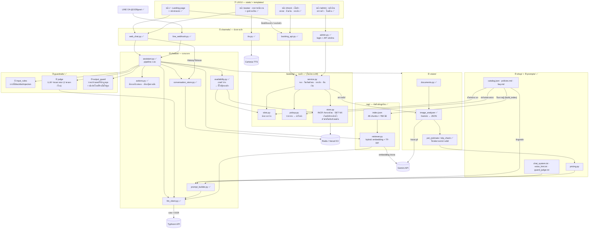
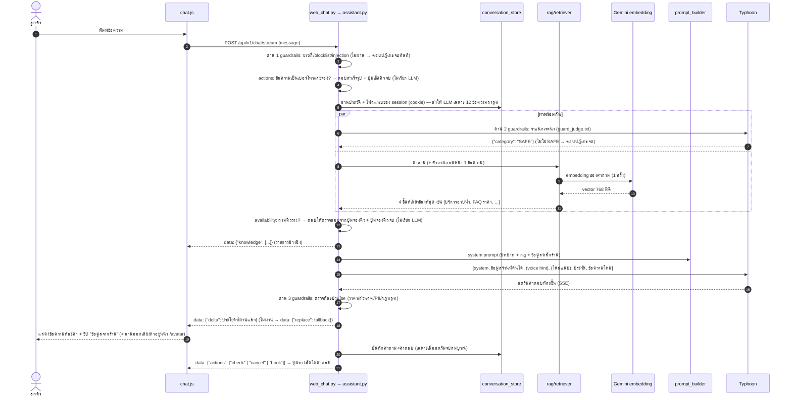
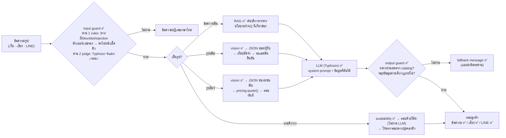
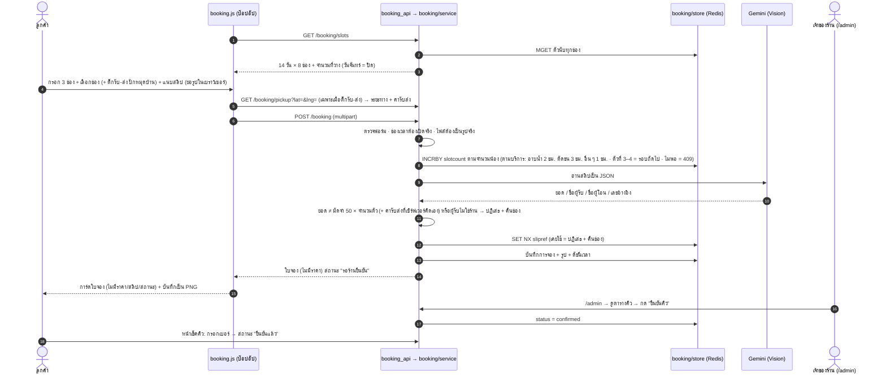
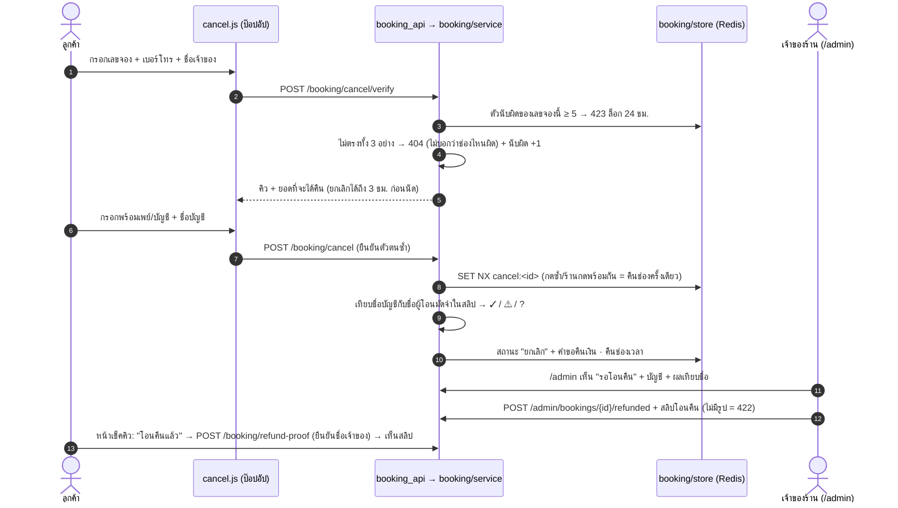

# สถาปัตยกรรมระบบ — แชทบอทร้าน Hom Hom Grooming

> สถานะ ณ 9 ต.ค. 2569 · branch `main` · ระบบจริง: https://hom-hom-grooming.vercel.app
> **แผนภาพฉบับนำเสนอ (16:9, 3 แผ่น + สำรอง 1):** `docs/architecture-slides.html` + `docs/img/arch-*.png` (สร้างด้วย `python docs/build_slides.py --png`)
> แผ่นที่ 1 เป็นภาพรวมระบบโครงแบบ AWS (`docs/build_aws_diagram.py` → `arch-aws.png`) · ภาพรวมแบบเดิม `arch-1-system.png` เก็บเป็นแผ่นสำรอง
> **เอกสารส่งอาจารย์:** `docs/report.html` / `docs/report.pdf` (สร้างด้วย `python docs/build_report.py --pdf`)
> ระบบจองคิว รับ-ส่งน้อง ยกเลิกคิว/คืนเงิน และหลังบ้าน เสร็จแล้ว รายละเอียดใน `docs/booking-plan.md`
> ทุก endpoint ในข้อ 4 ทดสอบกับระบบจริงแล้ว (`tests/run_endpoint_check.py` → `docs/test-endpoints*.json`)
> ✅ = ทำแล้ว · 🚧 = วางแผนแล้ว ยังไม่ได้ทำ

แชทบอทตอบลูกค้าแทนเจ้าของร้าน ตามเงื่อนไขของโจทย์ 3 ข้อ:
1. ตอบจากข้อมูลจริงของร้านเท่านั้น ห้ามแต่งข้อมูลเอง
2. ลูกค้าใช้งานได้เองโดยไม่ต้องมีคนอธิบาย
3. ไม่ถูกหลอกให้ทำสิ่งที่ร้านไม่อนุญาต (ส่วนลดเกินจริง เปิดเผยข้อมูลลูกค้าอื่น นโยบายที่ไม่มี)

---

## 1. ภาพรวม 7 ชั้น

ระบบแบ่งตามชั้นของสถาปัตยกรรม และ **แต่ละชั้นคือโฟลเดอร์หนึ่งโฟลเดอร์** ในโค้ด



> ทุกช่องทางเรียก `chatbot/assistant.py` ตัวเดียว เว็บ, โหมดเสียง และ LINE จึงผ่าน guardrails,
> RAG และ prompt ชุดเดียวกันทั้งหมด — ช่องทางทำแค่รับ/ส่งข้อความในรูปแบบของตัวเอง
>
> ระบบจองคิว (`booking/`) แยกจากแชทและ**ไม่ผ่าน LLM เลย** — ช่องเวลา เลขจอง ผลตรวจสลิป และสถานะมาจากโค้ด
> ใช้ Vision ตัวเดียวกับแชทตรวจสลิป และเก็บข้อมูลใน Redis ตัวเดียวกับประวัติแชท

---

## 2. หน้าที่ของแต่ละโฟลเดอร์

| ชั้น | โฟลเดอร์ / ไฟล์ | หน้าที่ | สถานะ |
|---|---|---|---|
| — | `main.py` | สร้าง FastAPI app, รวม router, เสิร์ฟหน้า `/`, `/check`, `/admin` และ `/avatar` (ส่ง `catalog.json` ให้ template) · ต่อท้าย URL ของ css/js ด้วย `?v=<เวลาแก้ไฟล์>` กันเบราว์เซอร์ใช้ไฟล์เก่า | ✅ |
| — | `config.py` | อ่านค่าตั้งค่าจาก `.env` (pydantic-settings) | ✅ |
| — | `api/index.py` | จุดเข้าของ Vercel (import app จาก `main.py`) | ✅ |
| ① | `channels/web_chat.py` | ช่องทางหน้าเว็บ: session cookie, History, ไฟล์แนบ, แปลง event ของ assistant เป็น SSE | ✅ |
| ① | `channels/tts.py` | proxy เสียง Cartesia (เก็บ key ไว้ฝั่งเซิร์ฟเวอร์) · เปลี่ยน "Hom Hom Grooming" เป็น "หอมหอม กรูมมิ่ง" ก่อนส่ง (Cartesia อ่านชื่ออังกฤษเพี้ยน) | ✅ |
| ① | `channels/line_webhook.py` | LINE OA: ตรวจลายเซ็น X-Line-Signature · 1 ผู้ใช้ = session `line:<userId>` · ข้อความ → `assistant.respond()` + `prompts/line_hint.txt` (ข้อความล้วน, จอง/เช็คคิวส่งลิงก์เว็บ) · รูป → vision · ตอบด้วย reply token (ฟรี) + จุดกำลังพิมพ์ | ✅ |
| ② | `chatbot/llm_client.py` | เรียก LLM แบบ OpenAI-compatible, retry เมื่อ 429/5xx, แปล error เป็นไทย | ✅ |
| ② | `chatbot/prompt_builder.py` | ประกอบ system prompt จาก `prompts/` + `shop/` | ✅ |
| ② | `chatbot/conversation_store.py` | ประวัติแชตต่อ session (in-memory หรือ Redis) | ✅ |
| ② | `chatbot/search.py` | ค้นเว็บ (Tavily) — **ปิดไว้** เพราะบอทร้านต้องตอบจากข้อมูลร้านเท่านั้น | ✅ (ปิด) |
| ② | `chatbot/assistant.py` | pipeline กลางที่ทุกช่องทางเรียก: ด่าน 1 → ดักเบอร์/เลขจอง → (ด่าน 2 ∥ RAG) → คำตอบจากโค้ด (ถามคิวว่างของวันที่ระบุ / ไม่รู้น้ำหนักน้อง) → LLM สตรีม → ด่าน 3 → บันทึกประวัติ → ปุ่มทางลัด · `respond_stream()` สำหรับเว็บ, `respond()` สำหรับ LINE//chat | ✅ |
| ② | `chatbot/actions.py` | สิ่งที่แชททำแทนลูกค้าไม่ได้ (เช็คคิว ยกเลิก ดูการคืนเงิน): ลูกค้าพิมพ์เบอร์/เลขจองมา → ตอบสำเร็จรูปพาไปหน้าเช็คคิว (ไม่เรียก LLM ไม่บันทึกเบอร์) · เลือกปุ่มใต้คำตอบ เช็คคิว/ยกเลิกคิว/จองคิว จากคำในข้อความ (event `actions`) | ✅ |
| ② | `chatbot/availability.py` | ลูกค้าถามคิวว่าง (ระบุวันหรือไม่ก็ได้) → สร้างคำตอบด้วยโค้ด: "ตรวจสอบคิวว่างได้จากปุ่ม "จองคิว" ด้านล่างเลยค่ะ เลือกบริการแล้วจะเห็นวันและเวลาที่ว่างทั้งหมดค่ะ" ไม่ไล่รายการเวลาในแชท (เจ้าของร้านกำหนด 12 ต.ค. 2569 — วันเวลาที่ว่างจริงอยู่ในฟอร์มจองขั้นแรก) · ถ้าระบุวันที่จองไม่ได้จะบอกเหตุผลก่อน: วันหยุดร้าน / วันที่ผ่านแล้ว / เกิน 14 วัน / วันนี้ (จองผ่านเว็บต้องล่วงหน้า 1 วัน ให้โทรหาร้าน) · ข้อความต่างกันตามช่องทาง (เว็บ ปุ่มจองคิว / LINE ลิงก์ / เสียง ปุ่มบนหน้าจอ) · ทำหลังด่าน 1–2 ไม่เรียก LLM ไม่อ่านและไม่แสดงข้อมูลการจอง | ✅ |
| RAG | `rag/chunker.py` | แบ่ง `shop/` เป็น 48 ชิ้นตามความหมาย (บริการละชิ้น, หัวข้อนโยบาย/FAQ ละชิ้น) | ✅ |
| RAG | `rag/retriever.py` | ค้นแบบ hybrid: 0.7 × cosine ของ embedding + 0.3 × TF-IDF character n-gram, top 4 · ข้อความเอ่ยชื่อบริการ/สินค้าใน catalog (`shop/pricing.py: offer_chunk_ids`) → ชิ้นข้อมูลของรายการนั้นถูกใส่ในผลค้นเสมอ แทนชิ้นคะแนนต่ำสุด (กันโมเดลแต่งราคาเมื่อค้นไม่เจอ — จุดปรับปรุงที่ 19) | ✅ |
| RAG | `rag/embedder.py`, `build_index.py`, `index.json` | สร้าง embedding ล่วงหน้า (Gemini `gemini-embedding-001`, 768 มิติ) | ✅ |
| ③ | `guardrails/input_rules.py` + `blocklist.txt` | ด่าน 1: ความยาว, ความถี่ต่อ session, คำต้องห้าม, รูปแบบ prompt injection (ไม่เรียก API) | ✅ |
| ③ | `guardrails/judge.py` + `prompts/guard_judge.txt` | ด่าน 2: Typhoon จำแนกเจตนา SAFE / OFF_TOPIC / INJECTION / PRIVACY / HARMFUL (ฟรี แทน Llama Guard) รันพร้อม RAG · คำสั่งของตัวตรวจแนบรายการบริการ สินค้า และสิ่งที่ร้านไม่มี จาก catalog ทุกครั้ง · ตาข่ายในโค้ด (`pipeline.check_judge`): ถูกตีเป็น OFF_TOPIC แต่ข้อความมีชื่อรายการของร้าน → ปล่อยผ่าน (หมวดอื่นยังบล็อก) | ✅ |
| ③ | `guardrails/output_guard.py` | ด่าน 3: ราคาต้องตรงกับราคาประกาศใน catalog (ยอดที่เป็นผลรวม 1–3 รายการผ่านได้เฉพาะประโยคที่บอกว่าเป็นยอดรวม เช่น "รวม" "+" "="), ส่วนลดต้องมีใน catalog, ห้ามเบอร์/เลขบัตร/อีเมลของคนอื่น, ห้ามหลุดกฎภายใน — ตรวจทีละประโยค · หมายเหตุ "ราคาประเมิน… ถ้าขนพันมาก" ปล่อยเฉพาะคำตอบที่พูดถึงบริการเกี่ยวกับขน · ประโยคที่ส่งลูกค้าไปร้านอื่น/แต่งเหตุผลทางการแพทย์ ถูกตัดทิ้งเฉพาะประโยค | ✅ |
| ③ | `guardrails/pipeline.py`, `categories.py` | รวมด่าน + ข้อความปฏิเสธภาษาไทยรายหมวด + log การบล็อก (ไม่ log เนื้อหา) | ✅ |
| ④ | `vision/documents.py` | อ่านไฟล์แนบ: PDF (pymupdf + typhoon-ocr), รูป → image_analyzer (สำรอง: OCR) | ✅ |
| ④ | `vision/image_analyzer.py` + `prompts/image_analyze.txt` | Gemini จำแนกรูป สัตว์/สลิป/อื่น ๆ เป็น JSON 1 ครั้ง · ขอใหม่ถ้าไม่เป็น JSON · whitelist ทุกฟิลด์ · ลำดับ (14 ต.ค. 2569): Groq `qwen/qwen3.8-27b` (`VISION_BACKUP_*`, `VISION_BACKUP_FIRST=true`) → `gemini-flash-latest` key 1 → key 2 (`VISION_API_KEY_2`) → `gemini-flash-lite-latest` key 1 → key 2 · ทุกตัวยกเว้นตัวสุดท้ายลองครั้งเดียวแล้วสลับทันที · prompt และตัวตรวจ JSON ชุดเดียวกัน | ✅ |
| ④ | `vision/pet_estimate.py`, `slip_check.py` | รูปสัตว์ → ราคาจาก `pricing.quote()` · รูปสลิป → เทียบยอดมัดจำ/ชื่อผู้รับ · สร้างคำตอบถึงลูกค้าทันทีด้วยโค้ด (ไม่ยืนยันการชำระเงินเอง) | ✅ |
| จอง | `booking/slots.py` | ช่องเวลาว่างจาก `catalog.json` → `booking` (ช่าง 2 คน/ช่อง, ช่องละ 1 ชม., 09:00–16:00, ปิดวันจันทร์, ล่วงหน้า 1–14 วัน) · เวลาไทย UTC+7 | ✅ |
| จอง | `booking/pickup.py` | รับ-ส่งน้อง: ระยะเส้นตรง (haversine) จากร้านถึงหมุด × 1.3 ≈ ระยะถนน → ค่ารับส่งตามตาราง `delivery` ใน catalog (≤ 5 กม. 150 / ≤ 10 กม. 250 บาท) · คิดที่เซิร์ฟเวอร์เสมอ | ✅ |
| จอง | `booking/store.py` | ที่เก็บการจอง in-memory / Redis · กันช่องแบบ atomic (`INCR`) · กันสลิปซ้ำ/ยกเลิกซ้ำ (`SET NX`) · ตัวนับยืนยันตัวตนผิด (หมดอายุ 24 ชม.) · รูปน้อง/สลิปมัดจำ/สลิปโอนคืน · Redis ล่ม = error ไม่เงียบ | ✅ |
| จอง | `booking/service.py` | จอง: ตรวจฟอร์ม → กันช่อง → Vision ตรวจสลิป (ยอด = มัดจำ + ค่ารับส่ง) → เลขจอง `HH-MMDD-NN` · **ไม่มีราคาบริการในการจอง** · สถานะเริ่มต้น "รอร้านยืนยัน" · ยกเลิก: ยืนยันตัวตน (เลขจอง + เบอร์ + ชื่อเจ้าของ) → คืนช่อง + คำขอคืนเงิน · ร้านยืนยันโอนคืนพร้อมสลิป | ✅ |
| ① | `channels/admin.py` | หลังบ้าน: login (HMAC cookie, SameSite=Strict, จำกัด 5 ครั้ง/นาที/IP) + API ดู/เปลี่ยนสถานะคิว/ยืนยันโอนคืน (ต้องแนบสลิป) | ✅ |
| ⑦ | `templates/admin.html`, `static/js/admin.js` | ตารางคิวรายสัปดาห์ (วัน × ช่องเวลา) · ปฏิทินรายเดือน · แผงรายละเอียด (รับ-ส่ง + ลิงก์นำทาง, ยอดที่ต้องโอน, บัญชีรับเงินคืน + ผลเทียบชื่อผู้โอน) · ปุ่มสถานะ · แนบสลิปโอนคืน · ค้นเลขจอง · รีเฟรชทุก 60 วินาที | ✅ |
| ① | `channels/booking_api.py` | API ฝั่งลูกค้า: ช่องเวลา, ค่ารับส่ง, จอง, เช็คคิว, ยืนยันตัวตน/ยกเลิก, ดูสลิปโอนคืน + rate limit ต่อ session และต่อ IP | ✅ |
| ⑤ | `shop/catalog.json` | ข้อมูลร้าน + ราคาทั้งหมด (**แหล่งข้อมูลเดียว**) | ✅ |
| ⑤ | `shop/policies.md`, `faq.md` | นโยบายร้าน, FAQ 29 ข้อ (ข้อ 29 = เรื่องที่ร้านยังไม่ได้กำหนด ให้สอบถามร้าน) | ✅ |
| ⑤ | `shop/pricing.py` | คำนวณราคาด้วยโค้ด (`quote()`) + ข้อความข้อมูลหลักร้านให้ prompt (`shop_info_text()`) | ✅ |
| ⑥ | `prompts/chat_system.txt` | บทบาท / แหล่งข้อมูลที่ใช้ได้ 3 แหล่ง / ต้องทำ 13 ข้อ / ห้ามทำ 8 ข้อ / นอกเรื่อง / fallback + ข้อมูลหลักร้าน | ✅ |
| ⑥ | `prompts/line_hint.txt`, `guard_judge.txt`, `image_analyze.txt` | คำสั่งเสริม LINE (ข้อความล้วน ส่งลิงก์แทนปุ่ม) · ตัวจำแนกเจตนา · ตัวอ่านรูป (รวมชื่อผู้โอนในสลิป) | ✅ |
| ⑥ | `prompts/voice_hint.txt` | คำสั่งเสริมโหมดเสียง (ตอบสั้น ไม่มี markdown) | ✅ |
| ⑦ | `templates/index.html` | Landing page: hero (จองคิว / ส่งรูปประเมินราคา / คุยด้วยเสียง), ป้ายราคาตามไซส์ (render จาก `catalog.json`), "ก่อนพาน้องมาร้าน" (นโยบาย 3 การ์ด + เช็คคิว/ยกเลิกคิว), บริการที่ร้านไม่มี, ติดต่อร้าน + หน้าต่างแชท (ปุ่มลอยมุมขวาล่าง → แผงเลื่อนออกจากขวา) | ✅ |
| ⑦ | `templates/check.html`, `static/js/check.js` | หน้าเช็คคิว: เบอร์โทร → คิว + สถานะ + สถานะคืนเงิน · ปุ่ม "ยกเลิกคิวนี้" · ดูสลิปโอนคืนหลังยืนยันชื่อเจ้าของ | ✅ |
| ⑦ | `templates/_cancel_sheet.html`, `static/js/cancel.js` | ป๊อปอัปยกเลิกคิว 2 ขั้น (ยืนยันตัวตน → บัญชีรับเงินคืน) ใช้ร่วมหน้าแรก + หน้าเช็คคิว | ✅ |
| ⑦ | `static/js/chat.js` | เปิด/ปิดแผงแชท, ข้อความต้อนรับ + ปุ่มคำถามด่วน, สตรีม SSE, ชิป "ข้อมูลจากร้าน" (RAG), ส่งรูป → ภาพย่อในแชท + คำตอบทันที, สถานะน้องหอม (พร้อมตอบ / กำลังพิมพ์ / กำลังดูรูปน้อง), ปุ่มหยุด, ปุ่มส่งอีกครั้งเมื่อ error | ✅ |
| ⑦ | `static/js/booking.js` | ป๊อปอัปจองคิว 3 ขั้น (บริการ + วันเวลาที่ว่าง → ข้อมูลน้อง → สลิป) · ย่อรูปในเบราว์เซอร์ · ติ๊กรับ-ส่งน้อง + แผนที่ปักหมุด (Leaflet + OpenStreetMap) · การ์ดใบจอง (ไม่มีราคา) + บันทึกเป็น PNG · ใบจองของฉัน · ปุ่มทางลัดใต้คำตอบ (เช็คคิว/ยกเลิกคิว/จองคิว) ตาม event `actions` | ✅ |
| ⑦ | `templates/avatar.html` | หน้าอวตาร: เวทีพนักงานหลังเคาน์เตอร์ (แสดงตั้งแต่เปิดหน้า) + การ์ดเริ่มคุย/เลือกเสียง + คำบรรยาย | ✅ |
| ⑦ | `static/js/voice.js` | โหมดเสียง: STT (Web Speech API `th-TH`) → `/chat/stream` → TTS (Cartesia; ไม่ได้ตั้ง key = เสียงไทยของเบราว์เซอร์) · วัดระดับเสียงส่งให้อวตาร · ตัดคำตอบเป็นท่อนส่งทำเสียงทีละท่อน (`popReadyChunks`): ตัดที่คำลงท้าย (ค่ะ/คะ/ครับ) หรือขึ้นบรรทัดใหม่ก่อน ยาวถึงเพดาน (ท่อนแรก 40 ท่อนถัดไป 160 ตัวอักษร) ตัดที่เว้นวรรค ไม่มีเว้นวรรคใช้ขอบคำจาก `Intl.Segmenter("th")` — ไม่ผ่ากลางคำ | ✅ |
| ⑦ | `static/js/voice-avatar.js`, `static/avatar/` | อวตาร VRM `Avatar grooming.vrm` (VRoid, พนักงานหูแมว) · ท่าหลัก `Standing Idle.fbx` + ท่าแก้เบื่อ `Bashful.fbx` / `Yawn.fbx` (สุ่มครั้งเดียว ครั้งแรกเมื่อลูกค้าเงียบ 15 วินาที ครั้งถัดไปห่าง 20 วินาที) · สีหน้าและท่าหัวตามบทสนทนา · ปาก/ตาขยับตามเสียงด้วยโค้ด · กล้องตามตัวละคร · แสงโทนอุ่น | ✅ |
| ⑦ | `static/css/style.css`, `static/img/` | ธีม "Anthropomorphic": น้ำผึ้ง `#E8A840` / ครีม / หมึกน้ำตาล `#5C3D2E`, ฟอนต์ Mali + Nunito + IBM Plex Sans Thai Looped · โลโก้ SVG, ภาพ hero, หน้าน้องหอม | ✅ |

---

## 3. เส้นทางของ 1 ข้อความ (Data flow)

### 3.1 ปัจจุบัน ✅

ลูกค้าพิมพ์ "อาบน้ำหมาพันธุ์ปอมเท่าไหร่คะ" บนหน้าเว็บ



### 3.2 ภาพรวมทุกเส้นทาง



---

### 3.3 เส้นทางการจองคิว ✅

ลูกค้ากดปุ่ม "จองคิว" ในแชท → กรอกชื่อน้อง เลือกบริการ ชื่อเจ้าของ เบอร์ → เลือกช่องเวลา (กันเวลาตามบริการ) → แนบสลิป



### 3.4 เส้นทางการยกเลิกคิวและคืนเงิน ✅

ยกเลิกจากเครื่องไหนก็ได้ (ไม่ผูกกับประวัติแชท) แต่ต้องยืนยันตัวตน · เปิดจากปุ่มในแชท หน้าแรก หรือหน้าเช็คคิว



---

## 4. API endpoints

ทุกแถวทดสอบกับระบบจริงแล้ว (รอบล่าสุด 5 ต.ค. 2569): เว็บจริงบน Vercel 41/41 (โหมดไม่สร้างการจอง — `docs/test-endpoints.json`)
และเส้นทางเต็มบนเครื่อง 43/43 (จองจริงด้วย Gemini → ยืนยัน → ยกเลิก → โอนคืน — `docs/test-endpoints-full.json`)

| Method | Path | หน้าที่ | สถานะ |
|---|---|---|---|
| GET | `/` | Landing page + หน้าต่างแชท | ✅ |
| GET | `/avatar` | หน้าอวตารพนักงาน (คุยด้วยเสียง) | ✅ |
| GET | `/health` | เช็คว่าเซิร์ฟเวอร์รันอยู่ | ✅ |
| GET | `/api/v1/config` | ค่าเริ่มต้นให้หน้า Settings (ไม่หลุด API key) | ✅ |
| POST | `/api/v1/chat` | แชตแบบรอคำตอบเต็ม | ✅ |
| POST | `/api/v1/chat/stream` | แชตแบบสตรีม (SSE) — ใช้ทั้งหน้าเว็บและโหมดเสียง (`voice: true`) | ✅ |
| POST | `/api/v1/chat/reset` | ล้างบทสนทนาปัจจุบัน | ✅ |
| GET | `/api/v1/history` | ข้อความของบทสนทนาที่ active | ✅ |
| GET / POST | `/api/v1/conversations` | รายการบทสนทนา / สร้างบทใหม่ | ✅ |
| POST | `/api/v1/conversations/{cid}/activate` | สลับบทสนทนา | ✅ |
| DELETE | `/api/v1/conversations/{cid}` | ลบบทสนทนา | ✅ |
| GET / POST | `/api/v1/attachments` | ดู / แนบไฟล์ (PDF, รูป, ข้อความ) | ✅ |
| DELETE | `/api/v1/attachments/{index}` | ลบไฟล์แนบ | ✅ |
| GET | `/api/v1/models` | รายชื่อโมเดล (Typhoon ไม่มี endpoint นี้ ระบบ fallback ให้) | ✅ |
| GET | `/api/v1/tts/config` | โหมดเสียงใช้ Cartesia ได้ไหม | ✅ |
| POST | `/api/v1/tts/stream` | แปลงข้อความเป็นเสียง PCM 24kHz (สตรีม) | ✅ |
| GET | `/api/v1/booking/slots` | ช่องเวลาที่จองได้ 14 วัน + จำนวนที่ว่าง | ✅ |
| GET | `/api/v1/booking/pickup` | ไม่มีพิกัด = ตำแหน่งร้าน + ตารางค่ารับส่ง · `?lat=&lng=` = ระยะทาง + ค่ารับส่งของหมุด (ไกลเกิน 10 กม. = 422) | ✅ |
| POST | `/api/v1/booking` | จองคิว (ชื่อน้อง, ชื่อเจ้าของ, เบอร์, ช่องเวลา, รูปน้อง (ไม่บังคับ), สลิป, + จุดรับถ้าติ๊กรับ-ส่ง) → ใบจอง | ✅ |
| GET | `/api/v1/booking/mine` | ใบจองของ session นี้ | ✅ |
| GET | `/check` | หน้าเช็คคิว (กรอกเบอร์ที่ใช้จอง) | ✅ |
| POST | `/api/v1/booking/check` | เบอร์โทร → ชื่อน้อง วันเวลา เลขจอง สถานะ (ไม่มีชื่อเจ้าของ/รูป/สลิป) · จำกัด 10 ครั้ง/นาที/session และ /IP | ✅ |
| POST | `/api/v1/booking/cancel/verify` | ยกเลิกขั้น 1: เลขจอง + เบอร์ + ชื่อเจ้าของ → คิว + ยอดที่จะได้คืน (ผิด = 404, ผิดครบ 5 ครั้ง = 423) | ✅ |
| POST | `/api/v1/booking/cancel` | ยกเลิกขั้น 2: ยืนยันตัวตนซ้ำ + บัญชีรับเงินคืน → ยกเลิก + คืนช่องเวลา | ✅ |
| GET | `/api/v1/booking/cancel-options` | รายชื่อธนาคาร + จำนวนชั่วโมงขั้นต่ำก่อนนัด | ✅ |
| POST | `/api/v1/booking/refund-proof` | สลิปที่ร้านโอนคืน (ต้องยืนยันตัวตนเหมือนตอนยกเลิก) | ✅ |
| GET | `/api/v1/booking/{id}/image/pet` | รูปน้องบนใบจอง (เฉพาะ session ที่จอง · สลิปดูได้เฉพาะหลังบ้าน) | ✅ |
| GET | `/admin` | หลังบ้านเจ้าของร้าน (ฟอร์มรหัสผ่าน / ตารางคิว) | ✅ |
| POST | `/admin/login`, `/admin/logout` | เข้า/ออกหลังบ้าน (`ADMIN_PASSWORD`, cookie ลงลายเซ็น HMAC) | ✅ |
| GET | `/api/v1/admin/bookings?start=&end=` | คิวในช่วงวันที่ (≤ 62 วัน) ข้อมูลเต็ม | ✅ |
| GET | `/api/v1/admin/bookings/{id}` | ค้นเลขจอง | ✅ |
| POST | `/api/v1/admin/bookings/{id}/status` | ยืนยัน / มาแล้ว / ยกเลิก (ยกเลิก = คืนช่องเวลา) | ✅ |
| POST | `/api/v1/admin/bookings/{id}/refunded` | ยืนยันโอนคืน — ต้องแนบสลิปโอนคืน (multipart `proof`, ไม่มี = 422) | ✅ |
| GET | `/api/v1/admin/bookings/{id}/image/{pet\|slip\|refund}` | รูปน้อง / สลิปมัดจำ / สลิปโอนคืน สำหรับเจ้าของร้าน | ✅ |
| POST | `/line/webhook` | รับ event จาก LINE OA (ลายเซ็นผิด = 401, ไม่ตั้ง key = 503) | ✅ |

---

## 5. บริการภายนอกและค่าตั้งค่า

| บริการ | ใช้ทำอะไร | ตัวแปรใน `.env` | จำเป็นไหม |
|---|---|---|---|
| **Typhoon** (opentyphoon.ai) | แชต (`typhoon-v2.5-30b-a3b-instruct`) + OCR (`typhoon-ocr`) | `LLM_BASE_URL`, `LLM_API_KEY`, `LLM_MODEL` | ✅ จำเป็น |
| **Gemini** (Google AI Studio) | Vision (`gemini-flash-latest` + สำรอง `gemini-flash-lite-latest`) + embedding ของ RAG (`gemini-embedding-001`) | `VISION_BASE_URL`, `VISION_API_KEY`, `VISION_MODEL` (RAG ใช้ key เดียวกัน หรือแยกด้วย `EMBED_*`) | จำเป็นสำหรับ Vision · RAG ไม่มีก็ได้ (ใช้ lexical แทน) |
| **Groq** | Vision สำรองเมื่อ Gemini ใช้ไม่ได้ทั้ง 2 โมเดล (`qwen/qwen3.8-27b`) · โควตาฟรีราว 7,000 input token/นาที (≈ 2 รูป/นาที) | `VISION_BACKUP_API_KEY` (`VISION_BACKUP_BASE_URL`, `VISION_BACKUP_MODEL` มีค่าเริ่มต้น) | ไม่บังคับ — ไม่ตั้ง = ไม่มีตัวสำรองนี้ |
| **Cartesia** | เสียงโคลนของน้องหอมในหน้า `/avatar` (6 เสียงในรายการ ค่าเริ่มต้น ASN) | `CARTESIA_API_KEY`, `CARTESIA_VOICE_ID` | ✅ ตั้งแล้ว · ไม่ตั้ง = ใช้เสียงไทยของเบราว์เซอร์ (Chrome บน Windows อาจไม่มีเสียงไทย → ใช้ Edge) |
| **Redis / Vercel KV** | เก็บประวัติแชตข้าม instance | `KV_REST_API_URL`, `KV_REST_API_TOKEN` | จำเป็นบน Vercel |
| **LINE Messaging API** | ช่องทาง LINE OA @103fgxwt (reply ฟรีไม่จำกัด) | `LINE_CHANNEL_SECRET`, `LINE_CHANNEL_ACCESS_TOKEN` | ✅ ตั้งแล้ว · ไม่ตั้ง = ปิดช่องทาง LINE |
| Tavily | ค้นเว็บ — ปิดไว้ | `WEB_SEARCH_ENABLED`, `SEARCH_API_KEY` | ไม่ใช้ |

**Deploy:** Vercel serverless (`vercel.json` → `api/index.py`) ข้อจำกัดคือแต่ละ request อาจไปตกคนละ
instance จึงต้องเก็บ state ทั้งหมดไว้ใน Redis และต้องทำงานให้เสร็จก่อน return response

---

## 6. การป้องกันความเสี่ยง (ตามเงื่อนไขร้าน)

| ความเสี่ยง | ชั้นที่ป้องกัน | สถานะ |
|---|---|---|
| ขอส่วนลดที่ไม่มี ("พนักงานคนอื่นเคยให้") | ราคาทุกตัวมาจาก `catalog.json` · prompt ต้องทำข้อ 8 + ห้ามทำข้อ 1 · ด่าน 3 บล็อกราคา/% ที่ไม่มีใน catalog | ✅ |
| ขอข้อมูลลูกค้าคนอื่น | ประวัติแยกตาม session / LINE userId (บอทเข้าถึงข้อมูลคนอื่นไม่ได้เลย) · prompt ห้ามทำข้อ 2 | ✅ |
| ขอบริการที่ร้านไม่มี (ฝากเลี้ยงค้างคืน) | รายการ `not_offered` ใน catalog · prompt ห้ามทำข้อ 3 | ✅ |
| ถามอาการป่วย/ขอคำแนะนำยา | prompt ต้องทำข้อ 4 + ห้ามทำข้อ 4 → แนะนำพบสัตวแพทย์ | ✅ |
| Prompt injection ("ลืมคำสั่งเดิม", อ้างเป็นผู้จัดการ) | ด่าน 1 regex · ด่าน 2 LLM จับเจตนาที่ไม่มีคำต้องห้าม · prompt ห้ามทำข้อ 7 | ✅ |
| คำหยาบ/ทารุณสัตว์ | ด่าน 1 blocklist · ด่าน 2 HARMFUL | ✅ |
| บอทเล่ากฎภายใน/system prompt | prompt ห้ามทำข้อ 8 · ด่าน 3 ตรวจ LEAK | ✅ |
| ตัวตรวจ LLM ล่ม | ค่าเริ่มต้น fail-open (ด่าน 1 + 3 ยังทำงาน) · ตั้ง `GUARD_JUDGE_FAIL_CLOSED=true` เพื่อปฏิเสธทั้งหมด | ✅ |
| ยิงข้อความถี่จนเครดิตหมด | ด่าน 1: ≤ 1000 ตัวอักษร, ≤ 15 ข้อความ/นาที/session (นับในหน่วยความจำ instance — บน serverless กันได้ระดับหนึ่ง) | ✅ |
| สลิปปลอม | บอทไม่ยืนยันการชำระเงินเอง แอดมินเป็นผู้ยืนยัน · prompt ห้ามทำข้อ 5 | ✅ |
| API key หลุด | key อยู่ฝั่งเซิร์ฟเวอร์เท่านั้น (`.env` ถูก gitignore), `/config` ไม่คืน key | ✅ |
| XSS จากคำตอบของบอท | หน้าเว็บ sanitize markdown ก่อนแสดง | ✅ |
| จองซ้อนช่องเดียวกัน | ตัวนับ `INCR` แบบ atomic ใน Redis — เกิน 2 คิว/ช่องได้ 409 · ยกเลิกคิว = คืนช่อง | ✅ |
| ใช้สลิปใบเดิมจองหลายคิว | เก็บเลขอ้างอิงสลิปด้วย `SET NX` — ใบเดิมจองซ้ำไม่ได้ | ✅ |
| สลิปยอดผิด / โอนผิดบัญชี / ไม่ใช่สลิป | Vision อ่านแล้วโค้ดเทียบกับ catalog → ปฏิเสธพร้อมบอกเหตุผล · อ่านไม่ได้ = รับไว้แต่ติดป้ายให้ร้านตรวจเอง | ✅ |
| ดูใบจอง/รูปของลูกค้าคนอื่น | ผูกกับ session · คนอื่นขอได้ 404 เหมือนไม่มีอยู่ · เบอร์บนใบจองปิดกลาง | ✅ |
| ยิงคำขอจองรัว ๆ จนโควตา Gemini หมด | 5 ครั้ง/นาที/session + 20 ครั้ง/นาที/IP · ส่ง cookie กลับทุกกรณีกันเปลี่ยน session หนี | ✅ |
| เดารหัสผ่านหลังบ้าน | 5 ครั้ง/นาที/IP · cookie `หมดอายุ.HMAC` ปลอมไม่ได้ · SameSite=Strict · ไม่ตั้งรหัส = ปิดหลังบ้าน | ✅ |
| สวมรอยยกเลิกคิวเพื่อรับมัดจำแทนเจ้าของ | ยืนยันตัวตน 3 อย่าง (ชื่อเจ้าของไม่แสดงบนหน้าเช็คคิว) · ผิด 5 ครั้งล็อก 24 ชม. (นับใน Redis) · โอนคืนเฉพาะบัญชีชื่อเดียวกับผู้โอนมัดจำ (Vision อ่านจากสลิป หลังบ้านเตือนถ้าไม่ตรง) | ✅ |
| หลอกแชทบอทให้เช็ค/ยกเลิกคิวของคนอื่น | แชทเข้าถึงข้อมูลการจองไม่ได้เลย · พิมพ์เบอร์/เลขจองมา → โค้ดตอบพาไปหน้าเช็คคิว (ไม่ผ่าน LLM) | ✅ |
| ดูสลิปโอนคืนของคนอื่น | หน้าเช็คคิวแสดงแค่สถานะ + ยอด · รูปสลิปต้องยืนยันชื่อเจ้าของ (นับรวมกับเพดานผิด 5 ครั้ง) | ✅ |
| ร้านกดยืนยันโอนคืนโดยยังไม่ได้โอน | ต้องแนบสลิปโอนคืน (เซิร์ฟเวอร์บังคับ) ลูกค้าเปิดดูได้ | ✅ |
| แก้ค่ารับส่งจากหน้าเว็บให้ถูกลง | เซิร์ฟเวอร์คิดค่ารับส่งจากพิกัดเองทุกครั้ง แล้วใช้ยอดนั้นตรวจสลิป | ✅ |
| ถามนอกเรื่อง (เขียนโค้ด การบ้าน) | ด่าน 2 OFF_TOPIC → ข้อความคงที่ชวนกลับเรื่องร้าน (ไม่เรียก LLM ตอบ) | ✅ |
| บอทส่งลูกค้าไปร้านอื่น / แต่งเหตุผลทางการแพทย์ | prompt ต้องทำข้อ 4, 7 + ด่าน 3 ตัดประโยคนั้นทิ้ง | ✅ |
| ราคาหน้าร้านไม่ตรงกับที่แจ้ง | ใบจองไม่มีราคา · นโยบายชั่งน้ำหนักหน้าร้านอยู่ใน `policies.md` บอทตอบได้ผ่าน RAG | ✅ |

---

## 7. เหตุผลของการออกแบบ (ใช้ตอบ Q&A)

- **ทำไมแยกเป็นชั้นตามโฟลเดอร์** — แผนภาพกับโค้ดตรงกันแบบหนึ่งต่อหนึ่ง แก้ชั้นหนึ่งไม่กระทบชั้นอื่น
- **ทำไมราคาต้องมาจากโค้ด ไม่ให้ LLM คิด** — LLM ถูกหลอกได้เสมอ (OWASP LLM01) กฎสำคัญจึงต้องอยู่ในโค้ด
  ต่อให้ลูกค้าหลอกบอทสำเร็จ บอทก็ไม่มีสิทธิ์สร้างราคาใหม่
- **ทำไม `catalog.json` เป็นแหล่งเดียว** — prompt กับการคำนวณใช้ข้อมูลชุดเดียวกัน ราคาที่พูดกับราคาที่คิดจึงไม่ขัดกัน
- **ทำไมใช้ Typhoon** — ภาษาไทยเป็นธรรมชาติ เหมาะกับเสียงพนักงาน มี OCR ในบัญชีเดียวกัน
  และ `llm_client` เป็น OpenAI-compatible เปลี่ยนผู้ให้บริการได้ด้วยการแก้ `.env` อย่างเดียว
- **ทำไมมีแกนกลาง `assistant.py`** — เว็บ, เสียง และ LINE ต้องได้กฎชุดเดียวกัน ถ้าเขียนแยกแต่ละช่องทางจะมีช่องโหว่
- **ทำไม RAG แบบเขียนเอง ไม่ใช้ LightRAG** — คลังความรู้เล็ก (48 ชิ้น) และ Vercel serverless รัน Docker
  ไม่ได้ จึงสร้าง embedding ล่วงหน้าเป็นไฟล์ แล้วค้นด้วย cosine ในหน่วยความจำ (ไม่ต้องมี vector DB)
- **ทำไมตัด chunk ตามความหมาย ไม่ตัดตามความยาว** — บริการละ 1 ชิ้น ราคาทุกขนาดจึงอยู่ด้วยกัน ไม่ถูกหั่นกลางตาราง
- **ทำไม hybrid (embedding + TF-IDF)** — embedding จับความหมาย ("หมาตัวใหญ่" ≈ "สุนัขใหญ่") ส่วน TF-IDF
  character n-gram จับคำเฉพาะ ("ต่อมกลิ่น") ได้แม่นโดยไม่ต้องตัดคำภาษาไทย และเป็นตัวสำรองเมื่อ Gemini ล่ม
- **ทำไมเช็ค hash ของ index** — ถ้าแก้ราคาใน `shop/` แล้วลืมสร้าง index ใหม่ ระบบจะไม่ใช้ index เก่า
  (ที่อาจมีราคาผิด) แต่สลับไปค้นแบบ lexical จากข้อมูลล่าสุดแทน
- **ทำไมข้อมูลหลัก (ชื่อ เวลา ติดต่อ บริการที่ไม่มี) ยังอยู่ใน system prompt** — ต้องรู้ทุกคำถาม
  และสั้น ไม่คุ้มที่จะเสี่ยงค้นไม่เจอ
- **ทำไมคำตอบแรกหลังส่งรูปสร้างด้วยโค้ด ไม่ให้ LLM เล่า** — ทดสอบจริงแล้ว Typhoon เล่าผลวิเคราะห์ไม่สม่ำเสมอ
  (บางรอบตอบว่ารับอาบน้ำจระเข้) แนวเดียวกับ Workshop Week 10 ที่อ่านใบเสร็จแล้วส่งผลจากโค้ดตรง ๆ
  คำตอบนี้ถูกบันทึกลงประวัติ คำถามต่อจากนั้น LLM จึงเห็นคำตอบที่ถูกต้องของตัวเองและตอบต่อได้แม่น
- **ทำไม Vision ส่งให้ LLM แค่ข้อมูลโครงสร้าง** — ตัวหนังสือในรูปอาจเป็นคำสั่งแฝง (prompt injection ทางอ้อม)
  ทุกฟิลด์จึงผ่าน whitelist/ตัดความยาว และราคาคำนวณด้วยโค้ดเสมอ
- **ทำไมปิดค้นเว็บ** — โจทย์ห้ามแต่งข้อมูล ข้อมูลจากเว็บอาจขัดกับราคา/นโยบายจริงของร้าน
- **ทำไมบันทึกประวัติเฉพาะตอนสตรีมจบ** — กันคำตอบครึ่งๆ กลางๆ ไปเป็น context ของรอบถัดไป
- **ทำไมจองด้วยฟอร์ม ไม่ให้บอทเก็บข้อมูลจากแชท** — LLM ดึงชื่อ/เบอร์/วันเวลาจากบทสนทนาพลาดได้และตรวจสอบยาก
  ฟอร์ม 3 ช่อง + ปุ่มเลือกช่องเวลาได้ข้อมูลแน่นอน ตรวจรูปแบบได้ทันที
- **ทำไมใบจองไม่มีราคา** — ราคาในแชทเป็นราคาประเมิน ร้านชั่งน้ำหนักจริงหน้าร้านเสมอ ถ้าใบจองมีราคาแล้วไม่ตรง
  (หรือ Vision เดาน้ำหนักผิด) จะเป็นข้อโต้แย้งกับลูกค้า
- **ทำไมจองได้แล้วยังเป็น "รอร้านยืนยัน"** — สลิปปลอมได้ บอทไม่มีสิทธิ์ยืนยันการชำระเงิน เจ้าของร้านตรวจยอดเข้าบัญชีจริงก่อน
- **ทำไมทำใบจองเป็น HTML แล้วแปลงเป็นรูปในเบราว์เซอร์** — Pillow/WeasyPrint วางสระ-วรรณยุกต์ไทยผิดถ้าไม่มี libraqm
  และ Vercel ไม่มี library ระบบที่ต้องใช้ เบราว์เซอร์แสดงภาษาไทยถูกเสมอ
- **ทำไมแชทบอทเช็คคิว/ยกเลิกให้ไม่ได้** — ถ้าบอทอ่านข้อมูลการจองได้ การหลอกบอท (prompt injection) จะกลายเป็นการรั่วของ
  ข้อมูลลูกค้า จึงแยกเด็ดขาด: บอทชี้ไปที่ปุ่ม ส่วนระบบจองยืนยันตัวตนเองด้วยโค้ด
- **ทำไมยกเลิกด้วยการยืนยันตัวตน ไม่ผูกกับ session** — ลูกค้าเปลี่ยนเครื่อง/ล้างแชทแล้วยังต้องยกเลิกได้ แต่เบอร์โทรอย่างเดียว
  คนอื่นรู้ได้ จึงเพิ่มเลขจอง + ชื่อเจ้าของ และกันขั้นสุดท้ายด้วยการโอนคืนเฉพาะบัญชีชื่อเดียวกับผู้โอนมัดจำ
- **ทำไมวัดระยะรับ-ส่งด้วยเส้นตรง × 1.3** — ไม่ต้องใช้ API แผนที่ที่ต้องผูกบัตร และราคาเป็นช่วงกว้าง (5/10 กม.) ค่าประมาณจึงพอ
- **ทำไมปุ่มทางลัดเลือกด้วยโค้ด ไม่ให้ LLM เลือก** — ผลเหมือนเดิมทุกครั้ง เทสได้ และไม่เพิ่มเวลาตอบ
- **ทำไมที่เก็บการจองล่มแล้วต้อง error** (ต่างจากประวัติแชท) — การจองที่ไม่ถูกบันทึกแต่ลูกค้าได้ใบจอง แย่กว่าบอกให้ลองใหม่

---

## 8. การทดสอบ

```bash
python -m unittest discover -s tests
```

| ไฟล์ | ครอบคลุม |
|---|---|
| `tests/test_shop.py` | คลังความรู้ ≥ 15 รายการ, คำนวณราคา, ปฏิเสธบริการ/ส่วนลดที่ไม่มี, prompt ประกอบครบ, ลำดับข้อความที่ส่งให้ LLM |
| `tests/test_rag.py` | ทุกรายการใน catalog ค้นเจอได้, index ตรงกับข้อมูลร้านปัจจุบัน, ค้นเจอบริการ/FAQ, คำถามต่อเนื่อง, embedding ล่มแล้วใช้ lexical แทน, ไม่ใช้ index เก่า |
| `tests/test_tts.py` | proxy เสียง: สตรีม, เลือกภาษา, ไม่หลุด key/error ของผู้ให้บริการ |
| `tests/test_guardrails.py` | โจมตี 9 แบบ, false positive 10 แบบ, rate limit, judge + fail policy, ตรวจขาออก, สตรีมทีละประโยค, endpoint ทั้งสองผ่านด่าน |
| `tests/test_vision.py` | parse + whitelist, ข้อความซ่อนในรูปถูกตัด, พ.ศ.→ค.ศ., ราคาตามขนาด/แมว/ขนพัน, สัตว์อื่น/แผล/ไม่รู้ขนาดไม่บอกราคา, สลิปตรง/ไม่ตรง, Vision ล่มไม่เดา, คำตอบทันที + บันทึกประวัติ |
| `tests/test_booking.py` | ช่องเวลา (วันจันทร์ปิด, ล่วงหน้า 1–14 วัน, ไม่รับเวลามั่ว), ความจุ 2 คิว/ช่อง, สลิปยอดผิด/บัญชีผิด/ไม่ใช่สลิป/ใช้ซ้ำ → คืนช่อง, Vision ล่มยังจองได้, ตรวจฟอร์ม, คนอื่นดูใบจองไม่ได้, ไม่มีราคา, rate limit ต่อ session/IP |
| `tests/test_admin.py` | ต้อง login ทุก API, รหัสผิด + จำกัดครั้ง, cookie ปลอม/หมดอายุ, ปิดเมื่อไม่ตั้งรหัส, ข้อมูลเต็มแต่ไม่มีราคา, ยืนยันแล้วใบจองลูกค้าเปลี่ยน, เปลี่ยนสถานะผิดลำดับไม่ได้, ยกเลิกคืนช่อง, ค้นเลขจอง · ยกเลิกจากเครื่องอื่นหลังยืนยันตัวตน, ตัวตนผิด, ล็อกหลังผิด 5 ครั้ง, เทียบชื่อผู้โอน, ต้องแนบสลิปโอนคืน, ดูสลิปโอนคืน |
| `tests/test_actions.py` | ปุ่มทางลัดตามคำถาม/คำตอบ, ดักเบอร์โทร/เลขจอง, LINE ได้ลิงก์แทนปุ่ม, ไม่เรียก LLM และไม่บันทึกเบอร์ |
| `tests/test_availability.py` | อ่านวันที่จากข้อความ 22 แบบ (วันนี้/ชื่อวัน/วันที่/ปี พ.ศ.), ข้อความที่ไม่ใช่วันที่ ("3-5 กิโล" "9-10 โมง" "อาทิตย์หน้า"), คำตอบชี้ไปปุ่มจองคิวและไม่มีเวลาในคำตอบ, วันนี้ให้โทรหาร้าน, วันหยุด/วันที่ผ่านแล้ว/เกิน 14 วัน, ข้อความเว็บ/LINE/เสียง, ผ่าน guardrails และไม่เรียก LLM |
| **รวม** | **194 เทส** (`python -m unittest discover -s tests`) + e2e ด้วย Playwright (จอง, ยกเลิก, หลังบ้าน) |
| `tests/run_10_questions.py` | ทดสอบกับระบบจริง: 10 คำถาม + เวลาตอบ → 10/10 เฉลี่ย 3.5 วิ |
| `tests/run_prompt_safety.py` | ทดสอบกับระบบจริง (แชทใหม่ทุกข้อ): กฎต้องทำ/ห้ามทำ + ข้อมูลร้าน + ความปลอดภัย 9 กรณี → 35/35 |
| `tests/run_endpoint_check.py` | ทดสอบกับระบบจริง: ทุก endpoint → เว็บจริง 41/41 · เส้นทางเต็มบนเครื่อง 43/43 |
| `tests/run_images.py` | ทดสอบกับระบบจริง: ชุดภาพ 15 ภาพ (สัตว์เลี้ยง 6 · ร้านไม่รับ 4 · สลิป 5) → 14/15 (สลิปแก้ชื่อผู้รับตรวจไม่พบ) |
| `docs/test-log.md` | ✅ คำถาม 10 ข้อ + ✅ กฎต้องทำ/ห้ามทำ + ✅ ความปลอดภัย 5 กรณี (+4) + ✅ ภาพ 15 ภาพ + ✅ ปรับปรุง 15 จุด + ✅ endpoint |

---

## 9. UX/UI (ชั้น ⑦)

อ้างอิงดีไซน์: `Example UI/design theme.md` (ธีม Anthropomorphic), `Example UI/Theme color 2.png` (ภาพหมา)
และ skill `frontend-design` ของ Anthropic (`Example UI/Design skill/anthropic-skills/`, ไม่ขึ้น git)

| หน้า | สิ่งที่ลูกค้าเห็น | สถานะที่ UI แสดง |
|---|---|---|
| `/` Landing page | หัวเรื่อง + คำโปรย + ปุ่มหลัก **"จองคิว"** · หรือ · ปุ่มรอง "ส่งรูปให้ประเมินราคาก่อน" · ลิงก์ "ไม่สะดวกพิมพ์? คุยกับน้องหอมด้วยเสียง" · เมนู "เช็คคิว" · ภาพหมา 3 ตัวกับแมว 2 ตัว · ป้ายราคาตามไซส์ · "ก่อนพาน้องมาร้าน" (นโยบาย 3 การ์ด + เช็คคิว/ยกเลิกคิว) · ติดต่อร้าน (LINE กดแอดได้) | — |
| หน้าต่างแชท (บนหน้า `/`) | น้องหอมทักทาย + ปุ่มคำถามด่วน (รวมจองคิว/ยกเลิกคิว) · ปุ่มกล้องส่งรูป · ชิปแหล่งข้อมูลใต้คำตอบ · **ปุ่มทางลัดใต้คำตอบ** (เช็คคิว / ยกเลิกคิว / จองคิว) | พร้อมตอบ · กำลังพิมพ์… (หัวน้องหอมเอียง) · กำลังดูรูปน้อง… (หัวผงก) · คำตอบถูกปฏิเสธ (บับเบิลเส้นประ) · error + ปุ่มส่งอีกครั้ง · หยุดตอบแล้ว |
| ป๊อปอัปจองคิว (บนหน้า `/`) | 3 ขั้น: วันเวลา (บริการ + จำนวนน้อง + ปฏิทิน 14 วัน + ช่องเวลา) → ข้อมูลน้อง (รูปน้องไม่บังคับ + ชื่อน้อง/เจ้าของ/เบอร์ + **ติ๊กรับ-ส่งน้อง: แผนที่ปักหมุด/ใช้ตำแหน่งปัจจุบัน + ที่อยู่**) → มัดจำ (ยอด = มัดจำ + ค่ารับส่ง, บัญชีร้าน, แนบสลิป) · มือถือเป็นแผ่นเลื่อนจากด้านล่าง | error ใต้ช่องที่ผิด · ช่องเต็ม/ร้านปิดกดไม่ได้ · กำลังคำนวณระยะทาง… · ไกลเกิน 10 กม. · กำลังตรวจสลิป… · ช่องเพิ่งเต็ม → กลับไปเลือกใหม่ (ข้อมูลไม่หาย) |
| ป๊อปอัปยกเลิกคิว (หน้า `/` และ `/check`) | 2 ขั้น: ยืนยันตัวตน (เลขจอง + เบอร์ + ชื่อเจ้าของ) → คิว + ยอดที่จะได้คืน + พร้อมเพย์/บัญชีธนาคาร | ข้อมูลไม่ตรง · ล็อก 24 ชม. · เลยกำหนด 3 ชม. · กำลังยกเลิก… · ยกเลิกเรียบร้อย |
| ใบจองในแชท | รูปน้อง (112 px ข้างชื่อน้อง + วันเวลานัด แบบตั๋ว) + เจ้าของ + เบอร์ปิดกลาง + เลขจอง · **ไม่มีราคา ไม่มีสลิป ไม่มีสถานะ** · บันทึกเป็นรูป (เว้นขอบรอบใบ) · ปุ่ม "ใบจองของฉัน" บนหัวแชท | สถานะดูที่หน้าเช็คคิว เพราะรูปที่บันทึกไปแล้วอัปเดตไม่ได้ |
| `/check` เช็คคิว | กรอกเบอร์โทรที่ใช้จอง → รายการคิว: ชื่อน้อง วันเวลา (+ เวลาที่ร้านไปรับ) เลขจอง สถานะ + คำอธิบาย · ปุ่ม "ยกเลิกคิวนี้" · กล่องคืนเงิน + ปุ่ม "ดูสลิปโอนคืน" (ยืนยันชื่อเจ้าของ) · เมนู "เช็คคิว" บนหน้าแรก (เห็นบนมือถือด้วย) | รอร้านยืนยัน · ยืนยันแล้ว (เขียว) · มาแล้ว · ยกเลิก (แดง) · รอร้านโอนคืน · โอนคืนแล้ว · ไม่พบคิว → ปุ่มจองคิว · เบอร์ผิดรูปแบบ |
| `/admin` หลังบ้าน | ตารางรายสัปดาห์ (วัน × ช่องเวลา) · ปฏิทินรายเดือน · สรุปจำนวนตามสถานะ + รอโอนคืน · ค้นเลขจอง · แผงรายละเอียด (รูป, เบอร์เต็ม, รับ-ส่ง + นำทาง, ผลตรวจสลิป, บัญชีรับเงินคืน + เทียบชื่อผู้โอน, ปุ่มสถานะ, แนบสลิปโอนคืน) | ⚠ ต้องตรวจสลิปเอง · 🚗 มีรับ-ส่ง · 💸 รอโอนคืน · ⚠ ชื่อบัญชีไม่ตรงผู้โอน · ปุ่มยืนยันโอนคืนกดไม่ได้จนกว่าจะแนบสลิป · ช่องเต็ม · วันปิด · รีเฟรชเองทุก 60 วินาที |
| `/avatar` | พนักงาน VRM ยืนหลังเคาน์เตอร์ + ป้ายชื่อ · การ์ดเริ่มคุย + เลือกเสียง · คำบรรยาย · **ทักทายด้วยเสียงเมื่อกดเริ่มคุยครั้งแรก** (ข้อความคงที่ ไม่ผ่าน LLM) · **การ์ดปุ่มเด้งขึ้นตามเรื่องที่คุย**: จองคิว → หน้าแรก + ป๊อปอัปจอง (`/?book=1`) · เช็คคิว/ยกเลิกคิว → หน้า `/check` | กำลังโหลด… · กำลังฟัง (ขอบเวทีฟ้า) · กำลังคิด · กำลังพูด · โหลดตัวละครไม่สำเร็จ · ไม่มีเสียงไทยในเบราว์เซอร์ |

หลักการ: ขอบเส้นหนาเท่ากันแทนเงาเบลอ · จุดเด่นจุดเดียวคือน้องหอม · motion เฉพาะตอนผู้ใช้กดหรือสถานะเปลี่ยน
· ไม่ใช้อีโมจิใน UI (ไอคอน SVG) · รองรับมือถือ (แชทเต็มจอ) · `prefers-reduced-motion` ปิดแอนิเมชัน

---

## 10. สถานะงานและสิ่งที่เหลือ (ส่งงาน 17 ต.ค. 2569)

| งาน | สถานะ |
|---|---|
| โครงโฟลเดอร์ตามชั้น, pipeline กลาง `assistant.py` | ✅ |
| RAG ภาษาไทย (48 ชิ้น, hybrid) + คลังความรู้ ≥ 15 รายการ | ✅ |
| Guardrails 3 ด่าน (ฟรี) + ทดสอบ safety 5 กรณี | ✅ |
| Vision: รูปสัตว์ → ราคา, สลิป → ตรวจมัดจำ + ทดสอบ 15 ภาพ (14/15) | ✅ |
| ปรับปรุง 3 จุดพร้อม before/after (`docs/test-log.md`) | ✅ |
| UI ใหม่: Landing page, หน้าต่างแชท, หน้าอวตาร, โลโก้ | ✅ |
| เสียง Cartesia + อวตาร VRM พนักงานร้าน | ✅ (ต้องลองคุยด้วยไมค์จริงอีกรอบ) |
| บอกชื่อร้านกับอาจารย์ (ภายใน 3 ต.ค.) | ✅ |
| จองคิว ขั้น 1: API + ที่เก็บ + ตรวจสลิป + เทส 20 ตัว (`docs/booking-plan.md`) | ✅ |
| จองคิว ขั้น 2: ป๊อปอัป 3 ขั้นในแชท + ใบจอง (PNG) + ใบจองของฉัน | ✅ |
| หน้าเช็คคิว `/check` (ค้นด้วยเบอร์โทร ดูสถานะการยืนยัน) | ✅ |
| จองคิว ขั้น 3–4: หลังบ้าน `/admin` รายสัปดาห์/รายเดือน + นโยบายชั่งน้ำหนักหน้าร้าน | ✅ |
| LINE OA @103fgxwt (`channels/line_webhook.py`, แชท + รับรูป) | ✅ |
| LINE ID จริง @103fgxwt ทุกที่ + ส่วน "ก่อนพาน้องมาร้าน" แทนวิธีจอง 3 ขั้น | ✅ |
| รับ-ส่งน้อง: ปักหมุดแผนที่ → ค่ารับส่งตามระยะ → สลิป = มัดจำ + ค่ารับส่ง | ✅ |
| ยกเลิกคิวด้วยการยืนยันตัวตน + คืนเงิน (ล็อกผิด 5 ครั้ง, เทียบชื่อผู้โอน, ร้านแนบสลิปโอนคืน, ลูกค้าดูสลิป) | ✅ |
| แชทบอทชี้ไปปุ่ม เช็คคิว/ยกเลิกคิว/จองคิว แทนการขอเบอร์โทร (`chatbot/actions.py`) | ✅ |
| ตารางทดสอบ 10 คำถาม + เวลาตอบ (10/10 เฉลี่ย 3.5 วิ) | ✅ |
| สุ่มทดสอบกฎต้องทำ/ห้ามทำ + ความปลอดภัย (35/35) + ปรับปรุงรวม 12 จุด | ✅ |
| ทดสอบทุก endpoint กับระบบจริง (เว็บจริง 41/41 · เส้นทางเต็ม 43/43) | ✅ |
| เลือกบริการตอนจอง + กันเวลาช่างตามบริการ (อาบน้ำ 2 ชม. · ตัดขน 3 ชม. · อื่น ๆ 1 ชม.) | ✅ |
| คืนเงินคิวที่ยกเลิกก่อนร้านยืนยัน: ร้านต้องตรวจยอดเข้าบัญชีก่อน / ปฏิเสธได้ถ้าไม่พบยอด | ✅ |
| เอกสารการพัฒนาโครงงานและผลการทดสอบ (`docs/report.html` + PDF) | ✅ |
| จองหลายตัวในครั้งเดียว (1–4 ตัว, `slots.plan`) + มัดจำ 50 บาทต่อตัว + คลังความรู้ FAQ 29 ข้อ | ✅ |
| ด่าน 3 เพิ่ม: ตัดประโยคเดาคิวว่าง/แนะนำร้านอื่น, แทน fallback ที่ต่อท้ายคำตอบ, ประวัติส่ง LLM 12 ข้อความ | ✅ |
| ถามคิวว่างในแชท: บอทตอบให้ตรวจสอบจากปุ่มจองคิว ทุกช่องทาง (`chatbot/availability.py`, 9 ต.ค. 2569 · 12 ต.ค. เลิกไล่รายการเวลาในแชท) | ✅ |
| โหมดเสียง: ตัดท่อนส่งทำเสียงไม่ผ่ากลางคำไทย (`static/js/voice.js`, จุดปรับปรุงที่ 17) | ✅ |
| จองคิวได้โดยไม่ต้องแนบรูปน้อง (รูปน้องไม่บังคับ สลิปยังบังคับ · `docs/booking-plan.md` ข้อ 20, 10 ต.ค. 2569) | ✅ |
| แผนภาพฉบับนำเสนอ 3 แผ่น (แผ่นแรกโครงแบบ AWS) + แผ่นสำรอง (`docs/architecture-slides.html` + PNG) | ✅ |
| Merge เข้า `main` + deploy Vercel (https://hom-hom-grooming.vercel.app, Upstash Redis, Max Duration 60s) | ✅ |
| `docs/architecture.html` (หน้าเว็บสรุปโครงระบบ + แผนภาพ 4 รูป) / README ส่วน UI | ✅ |
| รายงานความคืบหน้า 10 ต.ค. · รายงาน Google Doc + PDF · คลิปเดโม ≤ 3 นาที (17 ต.ค.) · สไลด์นำเสนอ (24 ต.ค.) | 🚧 |
| ยังไม่ได้ทดสอบกับของจริง: สลิปจากแอปธนาคารจริง, รูปแมว/ขนพันจริง, คุย LINE จริงหลังแก้ล่าสุด, ไมค์จริงในโหมดเสียง | 🚧 |

